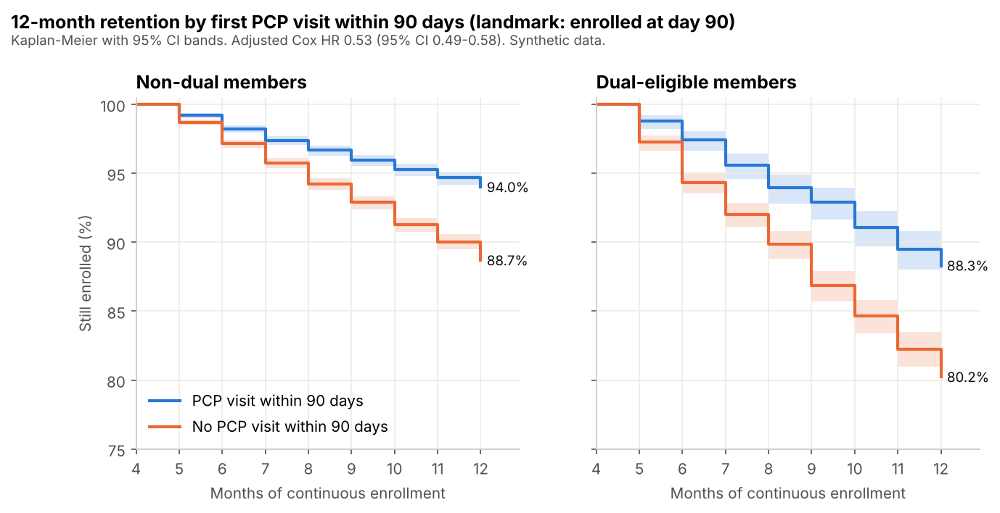
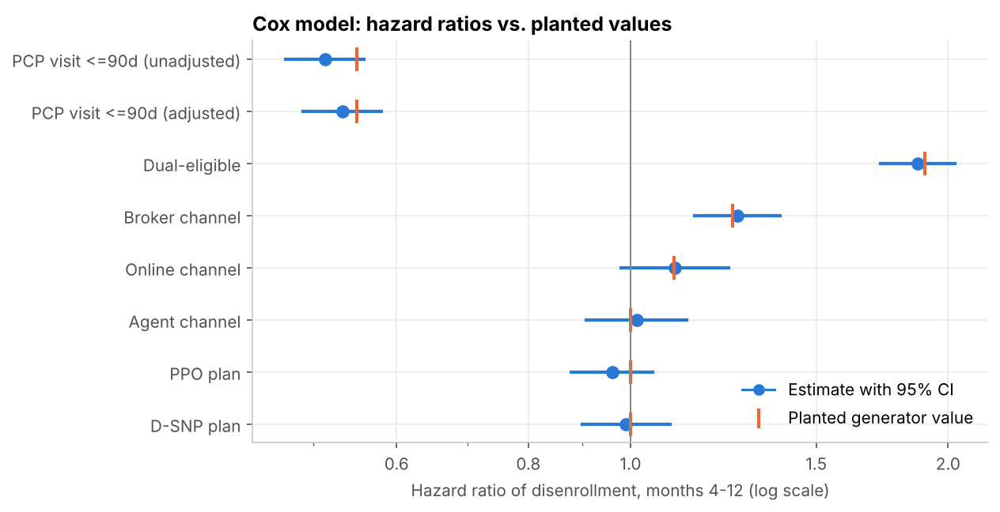
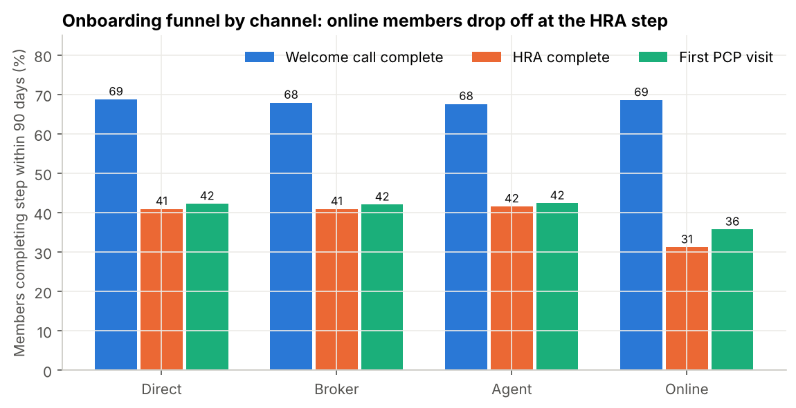
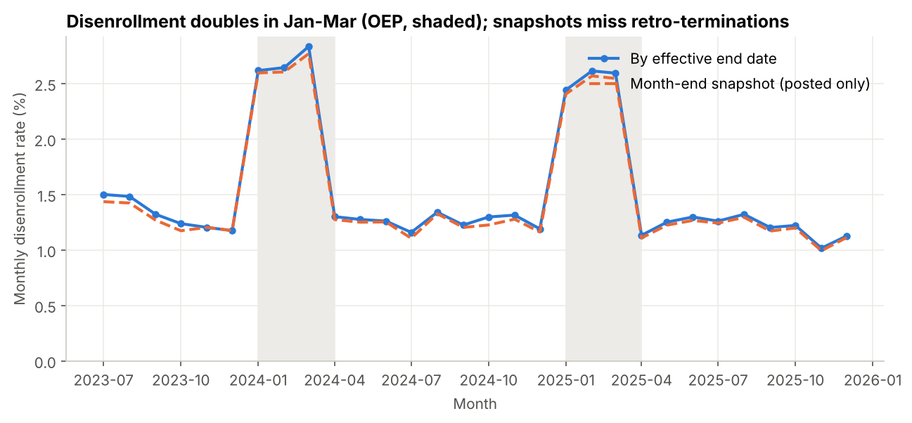
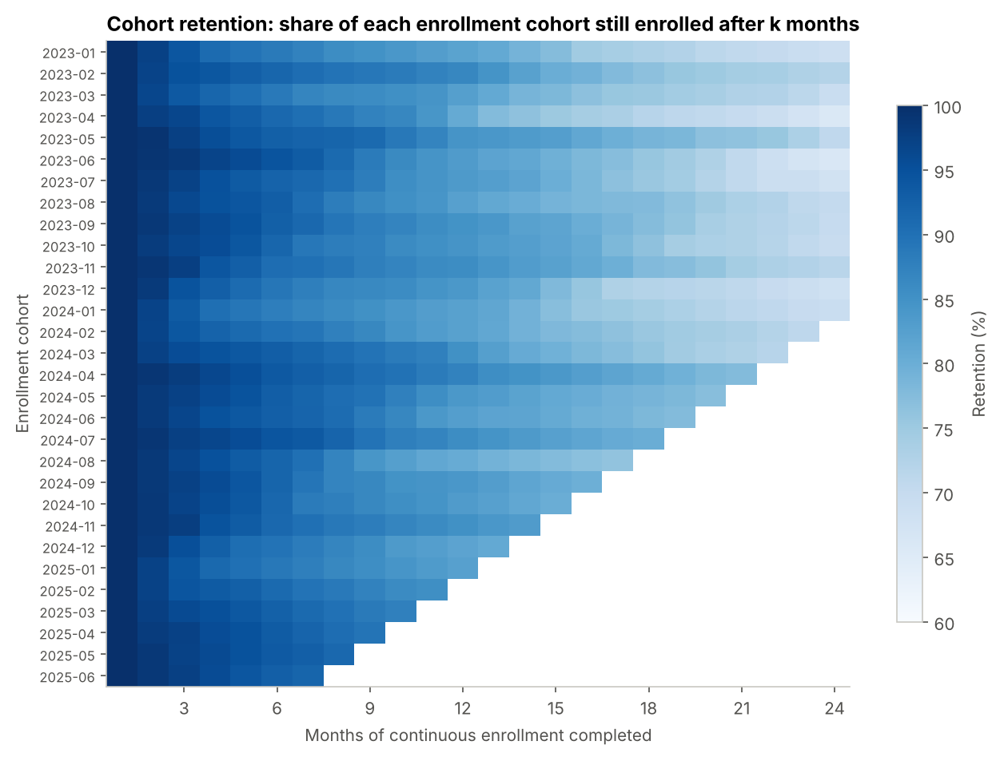
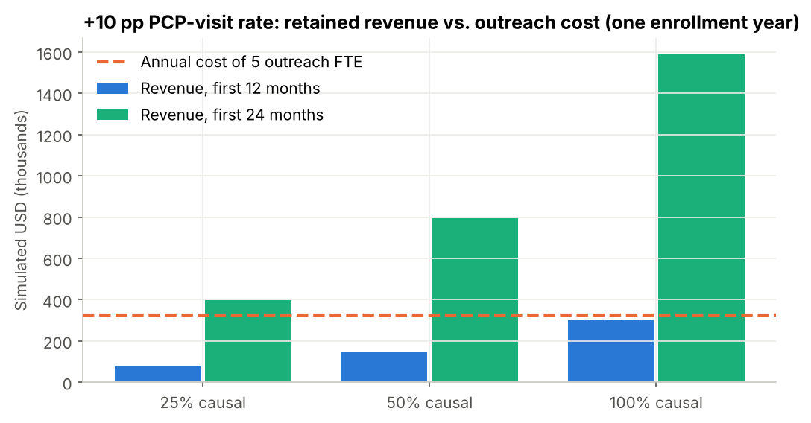

# Health plan member retention: which new members leave, and does early onboarding keep them?

**Business question:** Which new Medicare Advantage members leave in their first 12 months, and which onboarding steps in the first 90 days are linked to staying?

## TL;DR



- **A first PCP visit within 90 days is linked to a 0.53x disenrollment hazard** (Cox, adjusted for dual status, channel, plan type, age; 95% CI 0.49-0.58). Among members still enrolled at day 90, 12-month retention is 93.0% with a visit vs 86.7% without. The gap is widest for dual-eligible members: 88.3% vs 80.2%.
- **Online enrollees leak at the HRA step.** Of online members who complete the welcome call, 45.5% complete the HRA, vs about 60.4% in the other channels. Only 35.7% of online members see a PCP within 90 days (all members: 41.3%).
- **Disenrollment runs 2.12x higher in January-March** (Open Enrollment Period): 2.60% vs 1.23% per month. Month-end snapshots miss 2.0% of terminations because some are posted 30-60 days late.
- **Recommendation: do not fund a 5-FTE outreach team on this evidence alone.** Revenue from the first 12 months does not cover its $325K annual cost even if the whole association were causal. Counting 24 months of retained revenue, one year of outreach breaks even if at least 20% of the association is causal. Start with a randomized pilot on dual-eligible members, and plan staffing around the January peak.

> All data in this repository is synthetic, generated by `src/generate_data.py` (seed 42). No real patients, members, customers, or organizations. Findings describe the simulated plan, not any real Medicare Advantage population.

## Business context (simulated)

The VP of Member Experience at a simulated regional Medicare Advantage plan wants to know whether to fund a 90-day onboarding outreach team (welcome call, then health risk assessment (HRA), then first primary care (PCP) visit). The decision has three parts: fund it or not, how many outreach staff, and which members to call first.

The dataset covers 28,000 members who enrolled between January 2023 and June 2025, observed through 31 December 2025.

## Skills demonstrated

- **SQL:** gaps-and-islands to stitch enrollment spans into continuous coverage, window functions (`LAG`, running `MAX`, `ROW_NUMBER`), cross-feed de-duplication with time zone conversion, cohort matrices with censoring, small-cell suppression. All SQL is ANSI-style and ports to PostgreSQL.
- **Survival analysis:** Kaplan-Meier with Greenwood confidence intervals and a log-rank test (both implemented from scratch in `src/analysis.py`), Cox proportional hazards with a proportional-hazards check, and a landmark design to avoid immortal-time bias.
- **Causal care:** confounding by dual status shown directly (unadjusted vs adjusted hazard ratio); the PCP-visit effect is reported as an association, and the recommendation is a pilot, not a rollout.
- **Sizing:** outreach workload to FTE to cost, with retained revenue under 25/50/100% causal-share scenarios and a pilot power calculation.
- **Data quality:** 6 planted issue types, each detected, counted, and reconciled against the generator's truth file in `pytest`.
- **BI:** self-contained Plotly dashboard and a Power BI star-schema export.

## Approach

1. **Generate** a 7-table synthetic warehouse with planted effects and data-quality problems: [`src/generate_data.py`](src/generate_data.py). Realized planted values go to [`data/truth/planted_effects.json`](data/truth/planted_effects.json).
2. **Load** raw CSVs into DuckDB as text: [`src/load.py`](src/load.py).
3. **Stage and clean:** channel codes, null counties, UTC conversion and de-duplication of onboarding events, retro-term and overlap flags: [`sql/01_staging/`](sql/01_staging/).
4. **Model:** coverage islands (gaps-and-islands), member-level retention fact, person-month table: [`sql/02_marts/`](sql/02_marts/).
5. **Answer the business questions**, one SQL file each: [`sql/03_analysis/`](sql/03_analysis/).
   - [`01_cohort_retention_matrix.sql`](sql/03_analysis/01_cohort_retention_matrix.sql)
   - [`02_onboarding_funnel_by_channel.sql`](sql/03_analysis/02_onboarding_funnel_by_channel.sql)
   - [`03_retention_by_pcp_visit_and_dual.sql`](sql/03_analysis/03_retention_by_pcp_visit_and_dual.sql)
   - [`04_disenrollment_seasonality.sql`](sql/03_analysis/04_disenrollment_seasonality.sql)
   - [`05_segment_risk_table.sql`](sql/03_analysis/05_segment_risk_table.sql)
   - [`06_outreach_volume_sizing.sql`](sql/03_analysis/06_outreach_volume_sizing.sql)
6. **Model and size** in Python: Kaplan-Meier, log-rank, Cox, Poisson rate ratios, sizing, pilot power: [`src/analysis.py`](src/analysis.py).
7. **Report:** figures, dashboard, Power BI export, and this README (rendered from `reports/results.json` by [`src/report.py`](src/report.py), so the numbers cannot drift from the pipeline).

Metric definitions are in [`docs/methodology.md`](docs/methodology.md).

## Key findings

### 1. Members with an early PCP visit stay longer, and the gap is largest for duals

Population: 26,277 members still enrolled at day 90 (the landmark). Exposure is measured only during the first 90 days; follow-up starts after it.

| Group | 12-month retention, PCP visit within 90 days | No visit | Gap (pp) |
|---|---|---|---|
| All | 93.0% | 86.7% | 6.3 |
| Non-dual | 94.0% | 88.7% | 5.3 |
| Dual-eligible | 88.3% | 80.2% | 8.1 |

Log-rank chi-square = 246 (1 df). Cox hazard ratio for a PCP visit: **0.51** unadjusted (95% CI 0.47-0.56) and **0.53** adjusted (95% CI 0.49-0.58), on 26,277 members and 2,690 disenrollments. Dual-eligible members visit a PCP less often and leave more often (HR 1.87), so the raw comparison overstates the visit effect. Adjustment moves the estimate toward 1. The proportional-hazards check passes (Schoenfeld residual vs. time correlation -0.029, p = 0.14).

This is an association. Members who see a doctor early may be more engaged in ways the data does not capture. The sizing below treats the causal share as unknown.



### 2. The onboarding funnel leaks at the HRA step for online enrollees

Welcome-call completion is flat across channels (68.2% overall). The HRA step is where online members fall behind: 45.5% of online members who completed the welcome call finished the HRA, against about 60.4% for the other channels. Only 31.2% of all online members complete an HRA in 90 days (all members: 39.6%).



### 3. Churn is seasonal, and snapshot reporting undercounts it

Disenrollment runs 2.60% per month in January-March vs 1.23% in the other months (2.12x). Counting terminations by month-end snapshot gives 6,182 disenrollments in 2024-2025; counting by effective date gives 6,310, so the snapshot view misses 2.0%.



### 4. Who to call first

Across 24 channel x plan type x dual cells, 12-month retention ranges from 79.2% (broker / PPO / dual, n = 346) to 92.5% (direct / PPO / non-dual). Among members with no early PCP visit, dual-eligible broker enrollees lose the most: 22.4% leave within 12 months.



### 5. Sizing the outreach team

On average 769 new members a month are still enrolled at day 60 with no PCP visit (82% of members still enrolled at day 60). January cohorts peak at 1,701. At 3 attempts of 15 minutes each and 120 productive hours per FTE-month, that is 4.8 FTE on average (10.6 in the January peak). Funding 5 FTE at a simulated $65,000 each costs $325K a year.

If outreach raised the PCP-visit rate by 10 pp across one year of new members (11,507 enrollments in 2024), about 1,081 more members would have an early visit. Using the adjusted hazard ratio, each converted member gains 6.0 pp of 12-month retention and 0.28 member-months in months 4-12 (1.47 through month 24, assuming the effect persists). At a simulated $1,000 per member-month:

| Causal share of the association | Members retained at month 12 | Revenue, months 4-12 | Revenue, months 4-24 |
|---|---|---|---|
| 25% | 16 | $75K | $397K |
| 50% | 32 | $150K | $794K |
| 100% | 65 | $300K | $1.59M |

Break-even causal share: 108% on first-year revenue (above 100%, so not reachable), 20% on 24-month revenue.

A dual-only program needs 1.1 FTE (2 funded, $130K) for 172 members a month. It breaks even on 24-month revenue at a 28% causal share. Rounding up to whole FTEs makes small programs less efficient per member.



## Recommendations

1. **Run a randomized outreach pilot before funding the team (finding 1 and 5).** The visit-retention link is an association, and the business case depends on how much of it is causal. A two-arm pilot needs about 234 members per arm to detect a 12.2 pp lift in the 90-day visit rate (baseline 27.8% among members without a visit at day 60), which is about one month of workload. Measuring the retention effect directly would need 33,063 members per arm even if the effect were fully causal, about 7 years of outreach volume. So the pilot should confirm the visit lift, and the retention value should stay a modeled range.
2. **Fix the online HRA step (finding 2).** The online HRA rate is the largest single funnel gap. Adding the HRA to the online enrollment flow or the portal costs little compared with phone outreach.
3. **Call dual-eligible members first, staff for January, and report churn by effective date (findings 3 and 4).** Duals without an early visit have 80.2% 12-month retention, the lowest of any group. January cohorts put 1,701 members on the outreach list vs a 769 monthly average. Monthly churn reports should restate prior months when retro-terminations post.

## Validation: planted vs. recovered

The generator plants known effects. The pipeline recovers them without access to the truth file; `pytest` then compares the two. 21 of 21 checks pass. Hazard-model parameters pass when the planted value falls inside the 95% CI. Funnel rates and 12-month retention are compared with the realized values the generator wrote (tolerance 0.5 pp). Data-quality counts must match exactly.

| Planted effect | Kind | Planted / true | Recovered | 95% CI | Pass |
|---|---|---|---|---|---|
| PCP visit within 90 days, hazard ratio (Cox, adjusted) | parameter | 0.550 | 0.533 | 0.489 - 0.580 | yes |
| OEP (Jan-Mar) rate ratio | parameter | 2.000 | 2.028 | 1.932 - 2.129 | yes |
| Dual-eligible rate ratio | parameter | 1.900 | 1.879 | 1.788 - 1.974 | yes |
| Broker channel rate ratio | parameter | 1.250 | 1.283 | 1.212 - 1.358 | yes |
| Online channel rate ratio | parameter | 1.100 | 1.121 | 1.043 - 1.206 | yes |
| Agent channel rate ratio | parameter | 1.000 | 1.028 | 0.961 - 1.100 | yes |
| PCP visit rate ratio (Poisson, time-varying) | parameter | 0.550 | 0.542 | 0.513 - 0.573 | yes |
| Baseline monthly hazard (Apr-Dec, reference group) | parameter | 0.0120 | 0.0116 | 0.0110 - 0.0122 | yes |
| 12-month retention, Jan-Jun 2024 cohorts | realized | 0.835 | 0.835 | tolerance ±0.005 | yes |
| Welcome call completion (landmark) | realized | 0.682 | 0.682 | tolerance ±0.005 | yes |
| HRA completion, all (landmark) | realized | 0.396 | 0.396 | tolerance ±0.005 | yes |
| HRA completion, online (landmark) | realized | 0.312 | 0.312 | tolerance ±0.005 | yes |
| PCP visit within 90 days (landmark) | realized | 0.413 | 0.413 | tolerance ±0.005 | yes |
| PCP visit given HRA (landmark) | realized | 0.821 | 0.821 | tolerance ±0.005 | yes |
| PCP visit without HRA (landmark) | realized | 0.144 | 0.144 | tolerance ±0.005 | yes |
| Cross-feed duplicate events | data quality | 5,671 | 5,671 | exact match | yes |
| Retro-terminations | data quality | 145 | 145 | exact match | yes |
| Members with overlapping spans | data quality | 224 | 224 | exact match | yes |
| Null county_fips | data quality | 440 | 440 | exact match | yes |
| PCP visit before enrollment | data quality | 84 | 84 | exact match | yes |
| Non-standard channel codes | data quality | 4,163 | 4,163 | exact match | yes |

Rate ratios come from a Poisson model on 464,813 person-months with the PCP visit as a time-varying exposure. The Cox model's unadjusted hazard ratio (0.51) is further from the planted 0.55 than the adjusted one (0.53), which is the planted confounding by dual status at work.

## Data-quality issues found and how they were handled

| Issue (planted) | Found | Handling |
|---|---|---|
| Onboarding events duplicated across CRM and vendor feeds within 5 minutes | 5,671 rows (2.9% of events) | Converted CRM timestamps from US/Eastern to UTC first; then dropped a row when the prior row for the same member and event came from the other feed within 5 minutes |
| Mixed time zones (vendor UTC, CRM US/Eastern with DST) | all CRM rows | `AT TIME ZONE` conversion in staging |
| Retro-terminations posted 30-60 days after the effective end date | 145 spans | Retention uses effective dates; the snapshot view is shown separately to size the undercount |
| Raw member-month snapshot shows members active after termination | 135 member-months | Member-months are rebuilt from coverage islands instead of using the snapshot table |
| Overlapping enrollment spans | 224 members | Merged into continuous coverage with gaps-and-islands |
| Plan changes inside the organization (contiguous spans) | 1,430 spans | Merged; a plan change is not churn |
| Inconsistent channel codes ('BROKER', 'brkr', 'Direct ', 'web') | 4,163 members | Trimmed, lower-cased, mapped to 4 codes; 0 left unmapped |
| Null county_fips | 440 members | Mapped to 'UNKNOWN' and kept |
| pcp_first_visit dated before enrollment | 84 members | Event excluded; the member counts as having no visit unless a valid visit exists |

## How to reproduce

```bash
pip install -r requirements.txt
make all      # generate -> load -> staging -> marts -> analysis -> figures -> dashboard -> report -> tests
```

No network access is needed. Outputs: `reports/results.json`, `figures/`, `dashboard/index.html` (open in a browser), `powerbi/`.

## Limitations and next steps

- **Synthetic data.** The effects are the ones the generator planted. The value of this repo is the method and the checks, not the specific numbers.
- **Association, not causation.** The landmark design removes immortal-time bias but not unmeasured confounding. A randomized pilot is the next step.
- **Revenue, not margin.** Sizing uses a simulated $1,000 per member-month of revenue. Medical cost, risk adjustment, and Star-rating effects are out of scope.
- **Deaths count as disenrollment** in this simulation. A production version would treat death as a competing risk.
- **Effect persistence.** The 24-month sizing assumes the hazard ratio holds in year 2. That is untested here.
- **Next:** add the HRA-to-visit time as a continuous exposure, model re-enrollment as a separate outcome, and connect Star-rating measures.

## Repo map

```
src/generate_data.py      synthetic data + planted truth
src/load.py               CSV -> DuckDB (raw schema, text columns)
src/run_sql.py            runs sql/<folder>/*.sql in order
sql/01_staging/           typing, cleaning, de-duplication, flags
sql/02_marts/             coverage islands, member retention fact, person-month table
sql/03_analysis/          one file per business question
src/analysis.py           KM, log-rank, Cox, Poisson, sizing, pilot power, validation
src/figures.py            PNG charts
src/dashboard.py          dashboard/index.html (Plotly, inline JS)
src/export_powerbi.py     powerbi/*.csv star schema
src/report.py             renders README.md and docs/executive_summary.md from results.json
tests/                    data-quality and planted-effect tests
docs/                     data dictionary, methodology, executive summary
data/sample/              <=1,000 rows per table (full data is regenerated by make)
data/truth/               planted_effects.json
```

## About

Built by Adedeji M. Olugboja — linkedin.com/in/adedeji-olugboja
